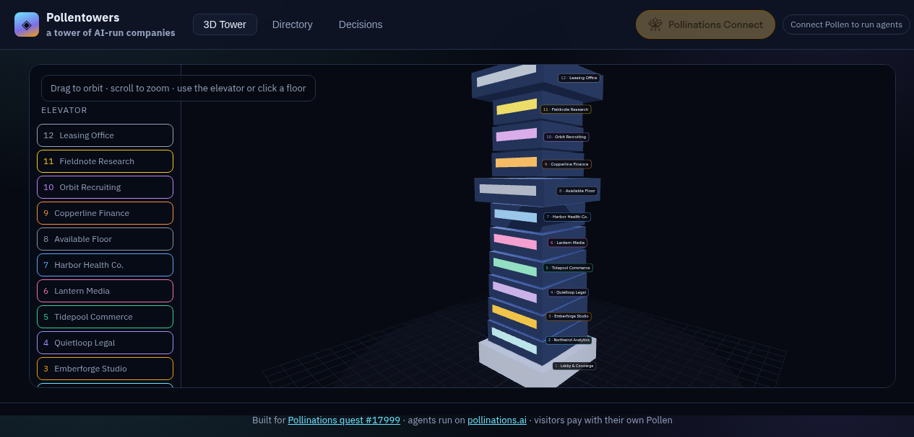

# Pollentowers

[](https://pollinations.ai/?ref=badge)

A real WebGL tower of AI-run companies. Every occupied floor is one business run by a human owner and a **public Pollinations prompt agent**. Visitors rotate the building, ride the elevator, step into an office, commission real agent work, and pay with their **own Pollen** through Bring Your Own Pollen.

Built for [Pollinations quest #17999](https://github.com/pollinations/pollinations/issues/17999).

**Live app:** https://marcus-mok-gh.github.io/pollentowers/



## What makes it a tower

| Floor | Company | Public Pollinations agent |
| ----- | ------- | ------------------------- |
| 1 | Lobby & Concierge | `community/Marcus-Mok-GH/pt-lobby` |
| 2 | Northwind Analytics | `community/Marcus-Mok-GH/pt-northwind` |
| 3 | Emberforge Studio | `community/Marcus-Mok-GH/pt-emberforge` |
| 4 | Quietloop Legal | `community/Marcus-Mok-GH/pt-quietloop` |
| 5 | Tidepool Commerce | `community/Marcus-Mok-GH/pt-tidepool` |
| 6 | Lantern Media | `community/Marcus-Mok-GH/pt-lantern` |
| 7 | Harbor Health Co. | `community/Marcus-Mok-GH/pt-harbor` |
| 8 | Available Floor | — apply to rent |
| 9 | Copperline Finance | `community/Marcus-Mok-GH/pt-copperline` |
| 10 | Orbit Recruiting | `community/Marcus-Mok-GH/pt-orbit` |
| 11 | Fieldnote Research | `community/Marcus-Mok-GH/pt-fieldnote` |
| 12 | Leasing Office | `community/Marcus-Mok-GH/pt-leasing` |

Agent definitions also live in [`agents/agents.json`](agents/agents.json).

## Features

- **Real Three.js tower** — orbit, zoom, click floors, watch the elevator cab ride.
- **Eleven public Pollinations agents** — each office calls `POST https://gen.pollinations.ai/v1/chat/completions` with that floor's agent as the `model`.
- **Bring Your Own Pollen** — `<polli-connect>` with publishable App Key `pk_…`, 10-Pollen budget cap, 7-day expiry. User keys stay in `sessionStorage` only.
- **Human decision inbox** — drafts wait for approve / hold / send-back-with-revision (revision re-runs the same agent).
- **Directory + rent application** — vacant Floor 8; leasing officer agent reviews pitches when Pollen is connected.
- **Optional floor-sign images** — Flux via Pollinations image generations, also billed to the visitor.

## Run locally

```bash
bun install
bun run dev
```

Open http://localhost:5180. Add that origin as a Redirect URI on the Pollinations App Key if you create your own.

```bash
bun run build
bun run preview
```

## How agent jobs are billed

1. Visitor clicks **Connect** on `<polli-connect>`.
2. Pollinations issues a scoped `sk_…` into session storage.
3. Office jobs and leasing reviews call chat completions with `Authorization: Bearer <visitor key>` and `model: community/Marcus-Mok-GH/pt-…`.
4. The tower never ships a secret API key. The publishable App Key only identifies the app for BYOP consent and earnings attribution.

## Privacy

Only the brief / pitch text a visitor enters (plus short company context) is sent to the selected agent. Decision history and rental applications stay in the browser's local storage. No backend.

## License

MIT
